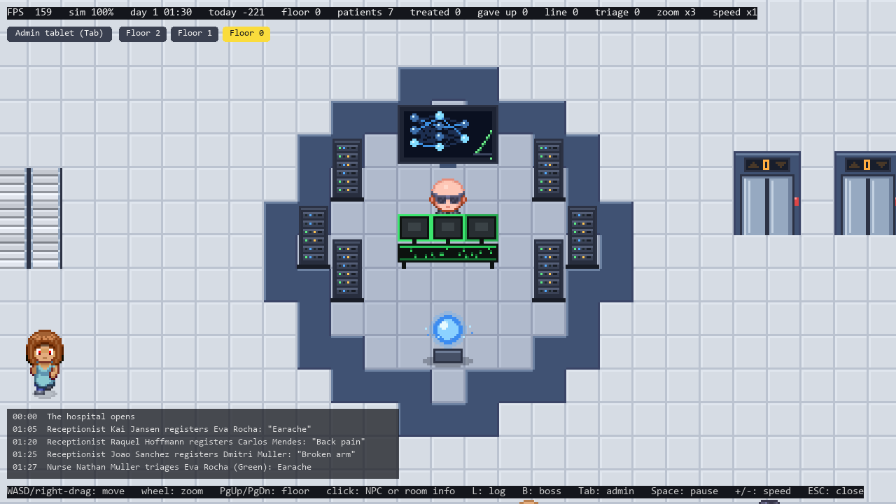
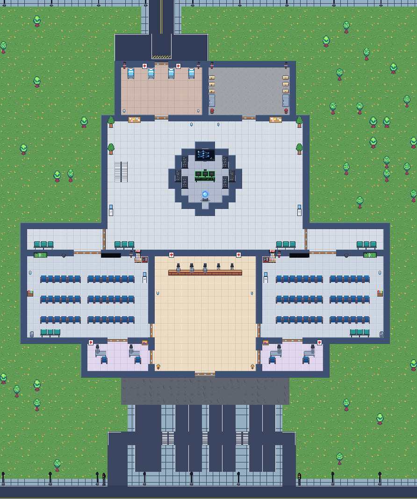
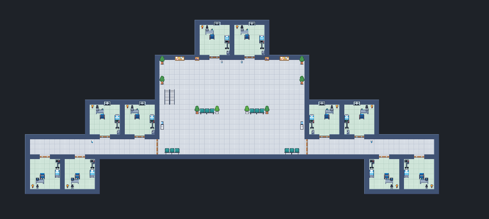
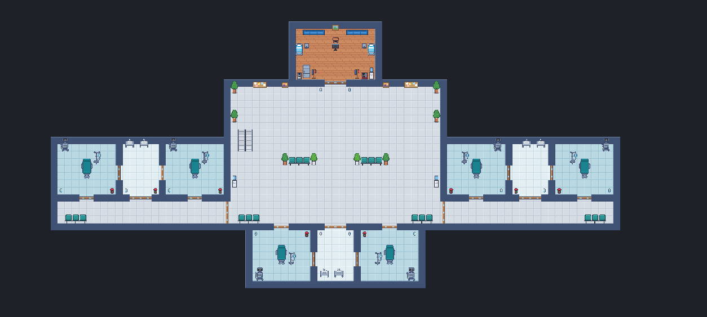
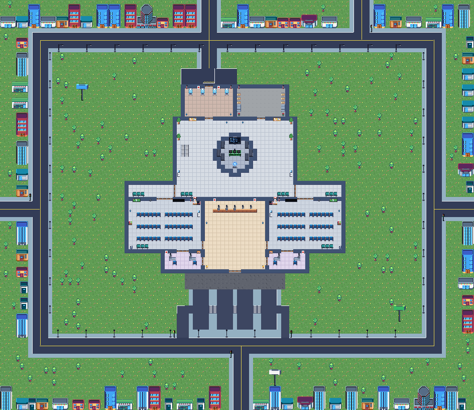
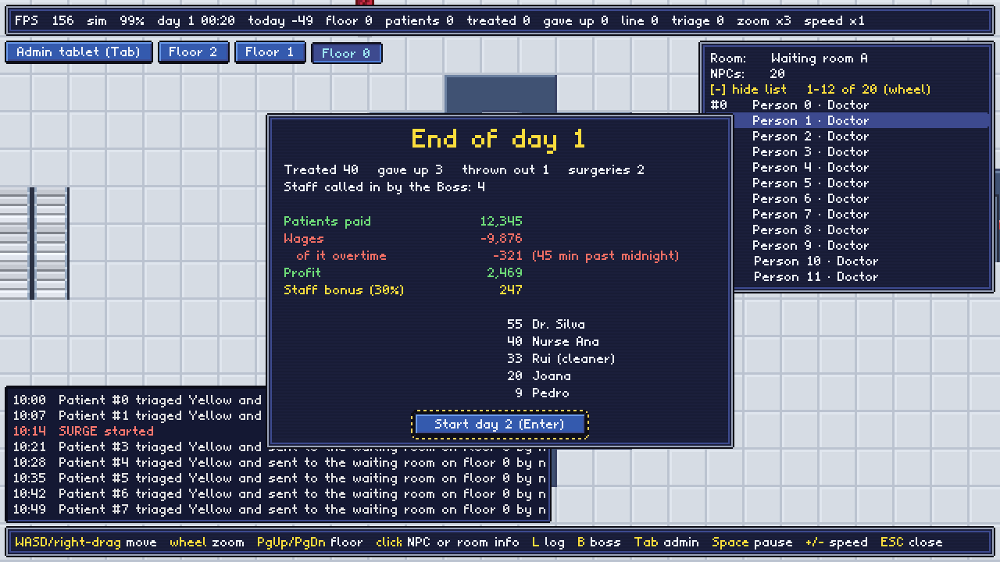
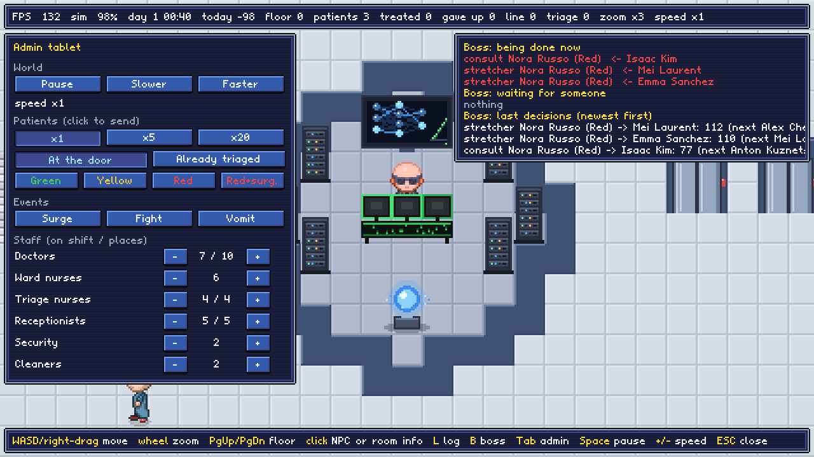
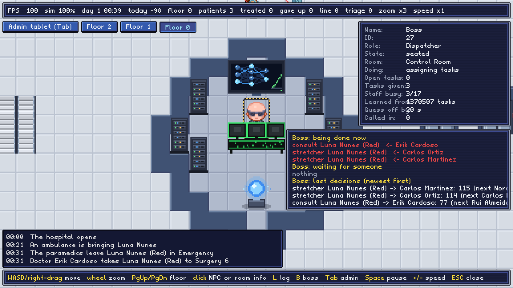

# Hospital simulator — Operating Systems project

A pixel-art hospital where **every person is a thread**. Patients arrive, register, get triaged, wait, see a
doctor (or go to surgery) and go home. Doctors, nurses, receptionists, security and cleaners do their jobs, and the
**Boss**, in the round control room in the middle, decides who does what.



## The story

This started as the project for *Comunicação e Sincronização entre Processos* (Universidade de Aveiro), and that
version was handed in a long time ago (it's still here: [`SO Projeto Hospital/`](SO%20Projeto%20Hospital/), in
Tkinter). I came back to it to understand process synchronisation better, and to make it more interesting to
watch: pixel art, animations, a city with cars, day and night.

At the same time I've been learning AI algorithms in class, so I tried them on the Boss, to see if it could make
the hospital run better. That's where all the money comes from: patients pay, staff cost wages, and the Boss
learns to make the most profit.

Fair warning: I had never made a map before, so the building isn't exactly *aesthetic*. It works, though.

## Run it

1. Python 3.12+ and the game library: `pip install pygame-ce`
2. The art packs (their licences don't allow uploading them): unzip each into `hospital2d/assets/third_party/`:

   | Folder | Pack |
   |---|---|
   | `hospital/` (with `Pngs/`) | [Hospital Top-Down Pixel Pack](https://soppycraft.itch.io/top-down-hospital) — Soppycraft |
   | `characters/` (`000.png` … `039.png`) | [2D Top-Down Pixel Art Characters](https://gamebetweenthelines.itch.io/top-down-pixel-art-characters) — Jephed |
   | `moderntown/` (with `sprites/`) | [Modern Town Tileset — Free Sample](https://chuckyassets.itch.io/modern-town-tileset-free-sample) — Chucky Assets |
   | `citypack/`, then `python slice_city.py` once in `hospital2d/` | [City Pack — Top Down](https://nyknck.itch.io/citypackpixelart) — NYKNCK |
   | `furniture/` (`Furniture (N).png`) | a furniture pixel-art pack (demo) |
   | `pixel_retro/` (the PNGs of its `textures/`, and its font, which comes inside `pixel_retro_lite.tres`, as `umlaut_pixel_8.ttf`) | [Pixel Retro UI Theme Lite](https://juliusschmidt.itch.io/godot-ui-themes-lite) — Julius Schmidt |

   The rest of the art (floors, walls, roads, bubbles, cars in each colour, the window icon...) is ours, in
   `hospital2d/assets/custom/`.
3. `cd hospital2d` and `python main.py`

**Controls:** WASD or right-drag to move · wheel to zoom · click a person or a room to see what's going on ·
`PgUp`/`PgDn` (or the floor buttons) change floor · `B` what the Boss is doing · `L` event log · `Tab` admin tablet
· `Space` pause · `+`/`-` speed · `Enter` next day · `ESC` close.

## The building

Three floors, and every one is **symmetric**: the right half is the mirror of the left one, rooms, doors and
furniture included (the only exception, on purpose: the stairs are on the left of the hall and both elevators on
the right).

**Ground floor — emergencies.** Reception in the middle, a triage room and a waiting room on each side, Emergency
(with the ambulance bay on top) next to the storage room, where the stretchers and the wheelchairs are kept. In the
middle of the hall, the Boss's round control room: server racks blinking, a big screen with a neural network
learning, the AI's core glowing. Below the entrance, the parking lot.



**First floor — the doctors.** Ten doctor's rooms around the hall (a desk, a chair for the patient, an exam bed).



**Second floor — surgery.** Six operating rooms, in blocks of operating room | disinfection room | operating
room (the doctor washes in between), and the staff's rest room on top, with sofas, a TV, beds, a coffee corner.



**The city** goes round the hospital: a ring road, streets out to the edges of the map, pavements, buildings,
lamps, trees, traffic lights. Cars drive on the right, give way to the car on their right at crossings (like in
Portugal), stop for people on the zebra crossings, and never crash: a crossing is taken all at once or not at all.



## What happens

**A patient's day:** street → reception line → registration → triage (Green / Yellow) → waiting room → called by
name on the screen and the loudspeaker → doctor → home. Most come by car (it parks, waits, and takes them home),
some by taxi.

**Red patients** come by **ambulance** (siren on, down its own street), two paramedics carry them to a bed in
Emergency, two nurses take them to surgery on a stretcher (in the elevator if needed), and once cured they go home
in a **wheelchair**: a nurse pushes them out to a car that comes for them.

**Things go wrong on purpose:** surges of patients, patients getting worse while they wait, people running out of
patience (they leave, complain at reception or start a fight: security comes), vomit (cleaners come with a mop),
tired staff going to rest. Everyone talks in speech bubbles.

**People move like people:** they walk around each other, give way in doorways (only one of them steps aside,
so nobody dances), look for another way when someone doesn't move, never walk across chairs, and staff run when
it's urgent.

**A day** is 24 hours of 60 seconds (24 minutes at x1), from day 1. At 23:00 the doors close, at 23:30 the doctors
make their last call (whoever no doctor has called yet goes home and comes back tomorrow, except the Reds), and
past midnight the staff cost overtime (x1.5). When the last patient leaves, the day's report: what patients paid,
the wages, the profit and the staff bonus. All the numbers are in [`hospital2d/config.py`](hospital2d/config.py).



**The admin tablet** (`Tab`) lets you play god: pause, change the speed, send patients of any colour, trigger a
surge, a fight or vomit, hire staff or send them home.



## The Operating Systems part

**4 processes**, talking through queues, plus **shared memory** for where everyone is:

```
 Arrivals ──patients──> Simulation ══positions (shared memory, seqlock, 60/s)══> UI (what you see)
    ^                       ├──────words: names, speech, cards (queue, 10/s)──> UI
    └─ "doors open" (Event) ┘───────events──────> Log (hospital.log)
```

Positions go through shared memory with a **seqlock** (the writer never waits for the reader, even if the reader
dies); text goes through a queue. That took moving data to the UI from 5.3 % of a CPU core to 2.1 %.

**Inside the simulation, one thread per person**, sharing the building:

| Problem | Solution |
|---|---|
| Two people stepping onto the same tile | a **lock**: checking and taking a tile is one step |
| The reception line | a **monitor** (`Condition`) |
| Registered patients waiting for a triage nurse | a **queue** (producer–consumer) |
| A doctor calls a patient and waits for them | two **events**: "I'm here", "you can go" |
| Only so many operating rooms and sinks | **semaphores** (emergencies first) |
| Two nurses meet at storage to bring a stretcher | **condition + events** (rendezvous) |
| Two elevators for the stretchers | a **monitor** each, with its own thread: first there, first served |
| One ambulance bay | a **semaphore**: the next ambulance waits up the road |
| Parking bays | a list under a **lock**: a car claims its bay before turning in |
| Two cars at a crossing | a crossing is taken whole or not at all (no deadlock); priority to the right |
| Two people blocking each other in a doorway | only one of them steps aside (no deadlock, no dancing) |
| Who does each task | the **Boss**, a thread scoring everyone by distance, fatigue and how busy they are |

**Limit:** about 900 threads on a Ryzen 5 3600 before the simulation can't keep up (Python's GIL).

## The AI part

The **Boss learns** to make the most profit in a day: who to see first among patients of the same colour (the most
urgent colour always goes first, like real triage), and when to **call in staff on call** and send them home (more
staff, more wages; fewer, longer waits and patients who give up). It also learns how long each task takes, and
who's quickest at what.

`python learn.py 8 4` plays 4 hospitals at once without the window, a whole day each round, trying small changes
and keeping what makes more money (Ctrl+C stops it; it saves after every round, so you can leave it running at
night). `python charts.py` draws how it's going (needs `pip install matplotlib`).



## Making it yours

- **Everything you see is an image file** you can edit (nothing is drawn by the code): walls, doors, roads, cars,
  people lying in bed, the urgency marks, the window icon, the yellow selection frame.
- **The building is a [Tiled](https://www.mapeditor.org/) map**, one per floor
  ([`hospital2d/maps/`](hospital2d/maps/)). Edit the left half, then from `hospital2d` run
  `python tools/mirror_rooms.py` (it copies it to the right) and `python tools/bake.py` (it makes the image files).
- **The numbers** (prices, wages, how long things take, how many patients...) are in
  [`hospital2d/config.py`](hospital2d/config.py).

Every file, every synchronisation, the tests and the performance numbers, in more detail:
[`hospital2d/README.md`](hospital2d/README.md).

```
cd hospital2d
python test_layout.py   # the building
python test_sim.py      # the simulation, with real threads (~5 min)
```

## Credits

- [Hospital Top-Down Pixel Pack](https://soppycraft.itch.io/top-down-hospital) — Soppycraft
- [2D Top-Down Pixel Art Characters](https://gamebetweenthelines.itch.io/top-down-pixel-art-characters) — Jephed, [Game Between The Lines](https://gamebetweenthelines.com/)
- [Modern Town Tileset — Free Sample](https://chuckyassets.itch.io/modern-town-tileset-free-sample) — [Chucky Assets](https://chuckyassets.itch.io/)
- [City Pack — Top Down — Pixel Art](https://nyknck.itch.io/citypackpixelart) — NYKNCK (buildings, cars, street furniture)
- [Pixel Retro UI Theme Lite](https://juliusschmidt.itch.io/godot-ui-themes-lite) and the Umlaut Pixel font — Julius Schmidt
- [m5x7](https://managore.itch.io/m5x7) font (speech bubbles) — Daniel Linssen, CC0
