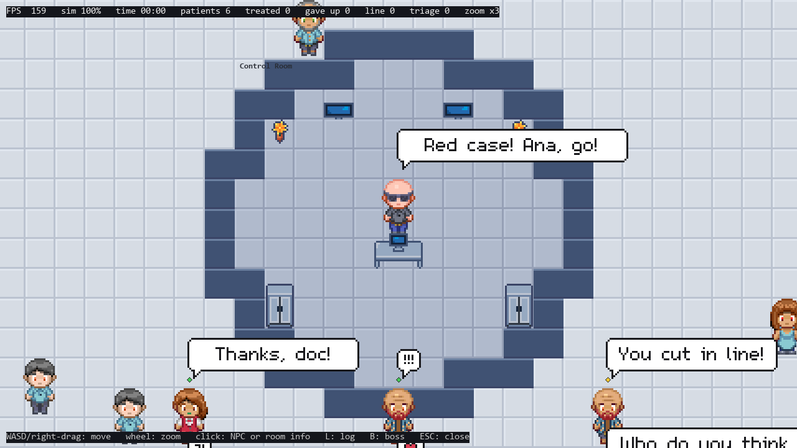

# Hospital simulator — Operating Systems project

A pixel-art hospital where **every person is a thread**. Patients arrive, register, get triaged, wait, see a
doctor (or go to surgery) and leave. Doctors, nurses, receptionists, security and cleaners do their jobs, and the
**Boss** — sitting in the round control room at the centre — decides who does what.

It's the project for *Comunicação e Sincronização entre Processos* (Universidade de Aveiro): **processes** that
only talk through queues, and **threads** that share memory and synchronise with locks, conditions, events and
semaphores.



## Run it

1. Install Python 3.12+ and the game library:
   ```
   pip install pygame-ce
   ```
2. Download the three free asset packs (their licences don't allow uploading them here) and unzip them into
   `hospital2d/assets/third_party/`:

   | Unzip into | Pack | Author |
   |---|---|---|
   | `hospital/` (with `Pngs/` inside) | [Hospital Top-Down Pixel Pack](https://soppycraft.itch.io/top-down-hospital) | Soppycraft |
   | `characters/` (`000.png` … `039.png`) | [2D Top-Down Pixel Art Characters](https://gamebetweenthelines.itch.io/top-down-pixel-art-characters) | Jephed — Game Between The Lines |
   | `moderntown/` (with `sprites/` inside) | [Modern Town Tileset — Free Sample](https://chuckyassets.itch.io/modern-town-tileset-free-sample) | Chucky Assets |

   Everything else (floors, walls, reception desk, speech bubbles…) is our own art, already in
   `hospital2d/assets/custom/`.
3. Start it:
   ```
   cd hospital2d
   python main.py
   ```

**Controls:** WASD or right-drag to move · mouse wheel to zoom · click a person (or any room) to see what's going
on · `B` see what the Boss is doing · `L` event log · `ESC` close.

To make it calmer or bigger, change [`hospital2d/config.py`](hospital2d/config.py): `TIME_SCALE` (0.5 = half
speed), `N_PATIENTS`, `ARRIVALS_PER_MINUTE`, `MAX_DOCTORS` (the building grows around the centre with it)…

## How it works, in short

**4 processes**, sharing nothing, talking only through queues:

```
 Arrivals ──patients──> Simulation ──snapshots──> UI (what you see)
                            └───────events──────> Log (hospital.log)
```

**Inside the simulation, one thread per person.** Each one runs its own routine step by step. A patient's is:

> street → reception line → registration → triage (Green / Yellow / Red) → waiting room → doctor → maybe surgery → exit

They share the building, so they synchronise:

| Problem | Solution |
|---|---|
| Two people stepping onto the same tile | a **lock**: checking and taking a tile is one single step |
| The reception line | a **monitor** (`Condition`): receptionists wait until someone is first in line |
| Registered patients waiting for a triage nurse | a **queue** (producer–consumer) |
| A doctor calls a patient and waits for them | two **events**: "I'm here" and "you can go" |
| Only so many operating rooms and sinks | **semaphores** |
| Who handles each task | the **Boss**, a thread that scores everyone by distance, fatigue and how busy they are |
| Two people blocking each other in a doorway | whoever has waited too long steps aside (no deadlock) |

**Things happen:** surges of patients, patients getting worse while they wait, people running out of patience
(they leave, complain at reception or start a fight — security comes), vomit (cleaners come), doctors dropping a
Green patient for a Red one, tired staff going to rest. Everyone talks in speech bubbles.

**Limit:** about 900 people (threads) on a Ryzen 5 3600 before the simulation can't keep up (Python's GIL).

More details — every file, every synchronisation, tests and performance numbers — in
[`hospital2d/README.md`](hospital2d/README.md). The first version of the project (Tkinter) is in
[`SO Projeto Hospital/`](SO%20Projeto%20Hospital/).

## Tests

```
cd hospital2d
python test_layout.py   # the building
python test_sim.py      # the simulation with real threads (~1.5 min)
python bench.py         # how far it scales
```

## Credits

- [Hospital Top-Down Pixel Pack](https://soppycraft.itch.io/top-down-hospital) — Soppycraft
- [2D Top-Down Pixel Art Characters](https://gamebetweenthelines.itch.io/top-down-pixel-art-characters) — Jephed, [Game Between The Lines](https://gamebetweenthelines.com/)
- [Modern Town Tileset — Free Sample](https://chuckyassets.itch.io/modern-town-tileset-free-sample) — [Chucky Assets](https://chuckyassets.itch.io/)
- [m5x7](https://managore.itch.io/m5x7) font (speech bubbles) — Daniel Linssen, CC0; included in `hospital2d/assets/fonts/`
